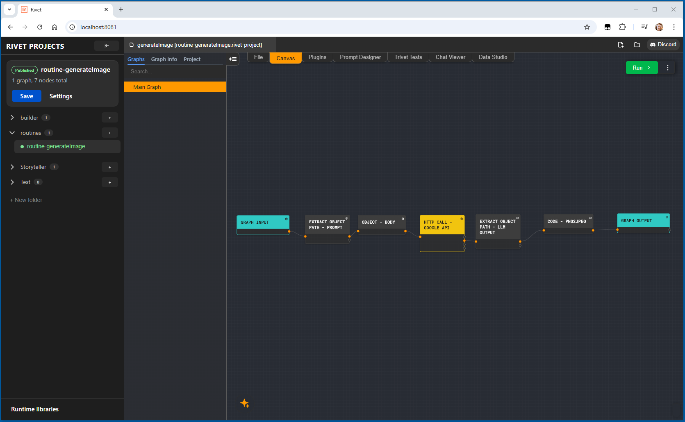

# Rivet Studio Server

Studio Server is the browser editor and workflow-serving platform in this monorepo.
It includes projects and folders, endpoints and web apps, recordings and replay,
Evaluations, remote debugging, and Code-node runtime libraries.



## Current installation contract

All supported deployments use PostgreSQL and S3-compatible storage. Docker Compose
and Kubernetes run the same managed control, execution, and Evaluation roles;
Kubernetes is not required for a single-machine installation.

Local storage automatically provisions private PostgreSQL and MinIO containers.
External storage uses the selected tier's URLs and credentials from the same `.env`.
Desktop, Node and CLI graph execution remain independent of this server stack.

## Prerequisites

- Node.js 24+, Git, and the repository-pinned Yarn release.
- Docker with Compose for the six single-machine commands.
- Kubernetes tools only for explicit cluster deployment or rehearsal.

Install once from the repository root:

```bash
corepack enable
yarn install --immutable
```

There is one workspace and lockfile, not a nested checkout or second installation.

## Development

Use `deploy/studio-server/.env.example` as the shared configuration reference.
Missing local credentials are generated once and added atomically to `.env`.
Use shared `RIVET_LOCAL_POSTGRES_PASSWORD`, `RIVET_LOCAL_S3_ACCESS_KEY_ID` and
`RIVET_LOCAL_S3_SECRET_ACCESS_KEY` for all tiers. Containers/data remain isolated.
Existing agreeing tier-prefixed credentials are preserved during upgrade, not
replaced with new passwords; conflicting old tiers require explicit reconciliation.

```bash
yarn studio-server:dev:local-storage
yarn studio-server:dev:external-storage
```

Both build the checkout's images and serve built assets, not Vite hot reload.
Only the proxy is published, on loopback; the dev port defaults to 8080.
Set shared `RIVET_PORT` to change it for any tier/storage choice. UI auth defaults
to `RIVET_SERVER_UI_AUTH_MODE=key`, using the configured `RIVET_KEY` to sign in.
To use `oauth`, first save OAuth provider settings and server-UI administrator
emails in key mode, then change the shared auth mode and restart. OAuth without
complete settings or an allowed administrator denies access, without key fallback.
PostgreSQL, MinIO and internal API/executor ports remain private.

`studio-server:dev` and `studio-server:vm` alias dev/local storage.
`studio-server:dev:recreate` rebuilds that same Docker installation.
`yarn dev` remains the desktop/editor development command.
Retired file/SQLite, bare-host and tunnel launch commands fail with guidance;
they do not redirect to a Kubernetes deployment or migrate data.

## Production Docker

Staging requires immutable candidate/promoted image evidence. Both production
storage choices require promoted release evidence, matching clean source,
installation confirmation and predecessor lineage:

```bash
yarn studio-server:staging:local-storage -- --manifest <candidate.json> --confirm rivet-staging-local
yarn studio-server:staging:external-storage -- --manifest <candidate.json> --confirm rivet-staging-external
yarn studio-server:prod:local-storage -- --manifest <promoted.json> --confirm rivet-prod-local
yarn studio-server:prod:external-storage -- --manifest <promoted.json> --confirm rivet-prod-external
```

All six commands read the same private `.env`. Tier settings use `RIVET_DEV_`,
`RIVET_STAGING_` and `RIVET_PROD_`, except shared `RIVET_LOCAL_*` credentials,
`RIVET_PORT` and `RIVET_SERVER_UI_AUTH_MODE`; default browser ports are 8080, 8082 and 8083.
With a shared port override, separate installations cannot run on that port at once.
Each independent installation needs a dedicated PostgreSQL database and distinct
Compose project. External buckets must exist. Keep deployment credentials,
encryption keys, private launcher state and durable volumes together.

### Single-VM HTTPS

The managed Docker listener is loopback HTTP. Configure a trusted TLS gateway
before public exposure; the old file/SQLite Compose TLS-overlay variables are
not consumed by this launcher. See the
[supported stack guide](../../developer-docs/studio-server/server-stack.md) and
[access/routing guide](../../developer-docs/studio-server/access-and-routing.md).
Local MinIO/PostgreSQL is not cloud durability or high availability; keep matching
database/object backups and encryption keys off-machine.

## Stop, recovery and migration

```bash
yarn studio-server:dev:local-storage -- --stop
yarn studio-server:prod:external-storage -- --stop --confirm rivet-prod-external
```

Stop drains application services before local storage and preserves data. Failed
startup drains partially started producers, preserves persistence and the pending
receipt, and never automatically rolls back schema or replays an uncertain write.
Follow the [recovery contract](../../developer-docs/studio-server/server-stack.md#ownership-startup-and-recovery)
before removing a stale launcher lock or repairing a pending deployment.

Existing file/SQLite installations are not upgraded in place or automatically
adopted. Export/transfer with their previous working release first and retain
their data and keys until the replacement is verified. For original version-1
legacy backups, use **Settings → Storage → Restore legacy backup**: validate,
confirm replacement, then Rivet drains, imports, verifies and restarts automatically.
This restores workflows, publications, recordings and supported settings, not
arbitrary SQLite or volume snapshots. Deletion is installation-scoped; unrelated
objects, tables and unproven historical versions remain protected.

## Kubernetes shape

Explicit `studio-server:dev:kubernetes-test` and
`studio-server:kubernetes:release` commands retain cluster ownership, reader,
release and recovery checks. The optional single-machine chart co-locates roles;
the cluster profile can scale execution separately. Neither choice changes the
application's shared PostgreSQL/S3 coordination.

See [Kubernetes](../../developer-docs/studio-server/kubernetes.md) for gateways,
capacity, isolated local PostgreSQL/MinIO rehearsal and production qualification.

## Monorepo map

- `packages/studio-server-api/`: API roles, storage and execution services.
- `packages/studio-server-web/`: dashboard, hosted editor and browser tests.
- `packages/studio-server-executor/`: Node executor service.
- `packages/studio-server-shared/`: browser/server contracts.
- `packages/studio-server-bootstrap/`: API/executor process bootstrap.
- `deploy/studio-server/images/`: shared deployment images.
- `deploy/studio-server/helm/`: cluster chart and overlays.
- `deploy/studio-server/compose/`: historical compatibility fixtures.
- `deploy/studio-server/scripts/`: current launchers, migration and verification.

## Documentation and verification

Start with [Supported Server Stack](../../developer-docs/studio-server/server-stack.md),
[Architecture](../../developer-docs/studio-server/architecture.md),
[Development](../../developer-docs/studio-server/development.md),
[Repository Structure](../../developer-docs/studio-server/repo-structure.md),
[Migration](../../developer-docs/studio-server/vm-to-managed-migration.md),
[Publication](../../developer-docs/studio-server/workflow-publication.md),
[Runtime Libraries](../../developer-docs/studio-server/runtime-libraries.md), and
[Deployment Status](../../developer-docs/studio-server/deployment-status.md).

Run focused contracts and relevant builds, then headless
`studio-server:ui:observe` for browser-visible changes. Destructive Docker/Kubernetes
restore fixtures require explicit opt-in and disposable owned installations.
Local results do not replace external cloud-provider or promoted release qualification.
